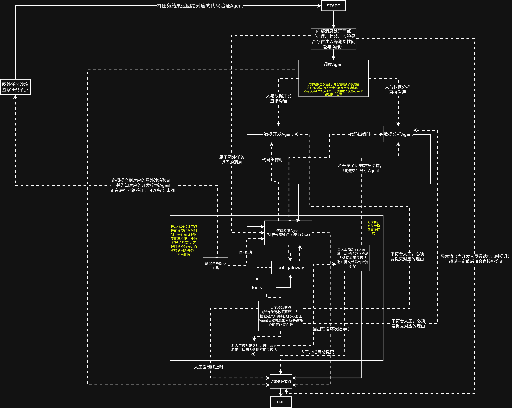
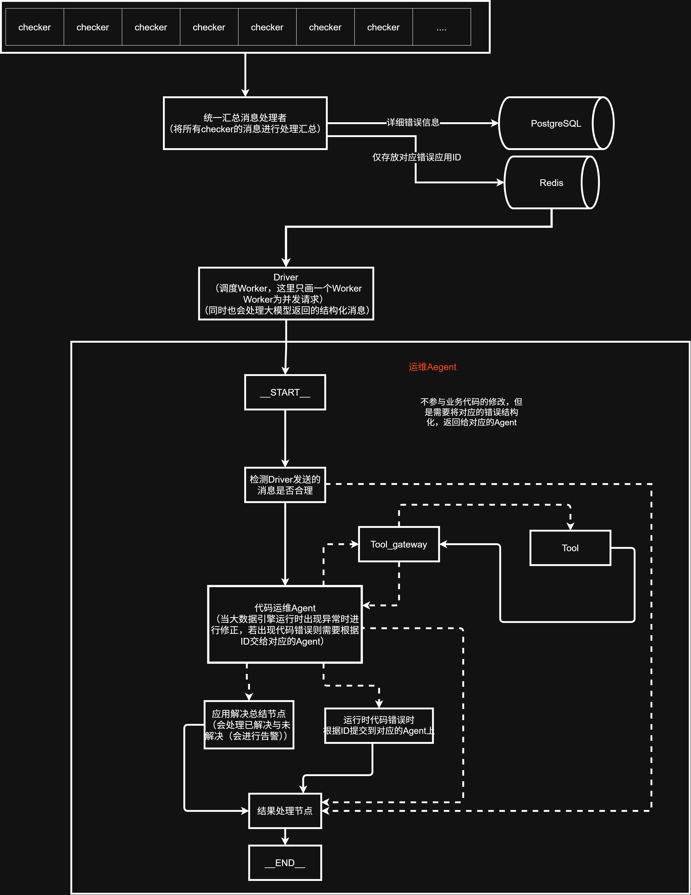

<h1 style="text-align:center;">
Multi-Agent BigData Platform（多智能体大数据平台）
</h1>

**⚠️ 注意：本项目已经有部分已经达到了准生产水平，但仍还有部分功能仍在完善中。**

## 系统化评测报告

9 个用例、六维评分、逐例证据与限制说明：

[system_eval_docs/system-eval-report-2026-11-08.md](system_eval_docs/system-eval-report-2026-11-08.md)

## 项目介绍

### 它是什么

Multi-Agent BigData Platform 是一个以 `Agent` 为主、`大数据` 为背景、`后端` 为辅的多智能体大数据平台。

它不是传统意义上单纯的 `Data Agent`，而是把 **大数据开发**、**大数据分析**、**大数据运维** 三件事放在同一套 Agent 编排里。

平台**不部署在大数据节点上**，而是独立部署在一台服务器上，通过 YARN / Flink REST、HDFS WebHDFS、SSH
去访问集群。它像插件一样可插拔，不侵入、也不影响集群本身的运行。

### 为什么做它

1. 市面上没有同类开源、覆盖「开发 + 分析 + 运维」全链路的完整平台。
2. 通用编码工具（Claude Code、Codex 等）什么都会做，但都不专注某个领域；这个平台只面向大数据场景。
3. 通过技术栈硬约束保证模型「专一」：开发 Agent 只会 `Java + Flink`，分析 Agent 只会 `Python + Spark`，不做跨栈乱写。

### 能力一览

| 链路 | 能力                                                             | 入口                                         |
|----|----------------------------------------------------------------|--------------------------------------------|
| 开发 | 按任务写 Java + Flink 应用，编译失败自动修复                                  | 对话                                         |
| 分析 | 按任务写 Python + Spark 分析代码，语法检查自动修复                              | 对话                                         |
| 质检 | 读代码 → 写测试 → 跑浅层 → **人工确认** → 跑深层 → **提交确认**                    | 开发/分析完成后自动进入                               |
| 运维 | 巡检 Spark/Flink/集群异常 → 只读取证 → 处理或转开发；**代码问题转给开发 Agent 修复并自动验证** | 后台常驻 + 运维看板（`connect_to_cluster=true` 时启用） |

## 架构与思想


### 开发链路



```
用户消息                              运维 Agent handover
  └─ handler（is_ops=true 时不进 dis_chat，直接进开发节点）
      ├─ dis_chat                    主调度：意图判断与任务派发，强制结构化输出
      │   ├─ data_develop            Java + Flink：写代码 / 修代码 / 登记提交信息
      │   └─ data_analysis           Python + Spark：写代码 / 修代码 / 登记提交信息
      └─ data_develop / data_analysis（运维转交：项目已存在，按 task_list 修复）
          └─ 语法检查                  mvn compile / compile()，失败打回（最多 4 次）
              └─ code_verify 子图（status：preliminary → shallow → deep → done）
                  ├─ 浅层测试         验证业务结果；连续失败 3 次直接交 work_end 终止
                  ├─ 人工确认         interrupt：允许 / 拒绝 / 强制终止
                  ├─ 深层测试         验证健壮性；超时转后台，由感知层回流后继续
                  └─ 收尾             提交确认 interrupt（is_submit=true 时）→ 父图 dis_chat（运维转交直接 work_end）
```

### 运维链路



```
YARN 运行中的应用
  └─ checker（Spark 5 项 / Flink 7 项 / 集群 3 项）
      └─ 统一错误池（PostgreSQL log.checker_log）+ Redis 通知队列
          └─ Worker（n_workers）抢 app_leases 锁
              └─ 运维 Agent：只读取证（工具按优先级串行/并行）
                  ├─ summary：记录错误状态 / 告警
                  └─ handover：把应用源码搬到 tmp_code，后台起开发图
                      ├─ 开发 Agent 修复 → 质检 Agent 验证 → 人工提交确认
                      ├─ 应用锁保持到流程结束；结果写回 log.agent_runs 并解锁
                      └─ 前端在「Agent 历史 → 查看开发 Agent」里查看/恢复中断
```

### 几个关键设计

- **主调度不写代码**：`dis_chat` 只输出「派给谁、任务是什么」，避免上下文膨胀和越权。
- **强制结构化输出**：调度与质检都绑定 Pydantic 模型，必须调用工具返回结果，不解析自由文本。
- **人工确认用 LangGraph `interrupt`**：图在节点中间停住，前端拿到 payload 后决定继续、打回或终止。
- **两层测试**：浅层验证业务结果，深层验证抗造；深层超时用 `TaskSupervisor` 移交后台，完成后由感知层把结果送回原会话。
- **运维转交复用开发链路**：`handover` 不经过 `dis_chat`，按 `app_type` 直接进 `data_develop` / `data_analysis`；开发线程
  id 固定为 `ops:{运维session_id}`，验证结束后回到父图 `work_end`，不回到对话。
- **转交期间应用锁不释放**：运维运行记录保持 `PAUSED`、`app_leases` 保留，新任务不能接管；开发流程跑到 `work_end`
  后才写回 `log.agent_runs` 并解锁。深层测试转后台的那一轮不结算，等感知层回流跑完再结算。
- **旁挂部署**：平台不装在大数据节点上，所有集群操作都走 REST / SSH / WebHDFS。

### 前端对话体验

- **Markdown / Mermaid**：`markdown-it` 负责解析，原始 HTML 关闭；Mermaid 代码块由 Mermaid 懒加载渲染。
  Mermaid 只在消息流式结束后渲染，避免每个 token 重建 SVG；人工确认面板里的“流程图”同样生效。
  人工确认前，后端用 `merman` 校验 CVA 产出的 `mermaid_flowgraph` 并做确定性修复；修不好回模型重修一次，
  仍失败则省略图并提示。前端保留一次保守修复作为其它来源的兜底，修不好则保留源码并标红。
- **打字机**：后端把最终 `output_msg` 按 6 字/30ms 分帧推送（`routers/ai_chat.py::_final_frames`），
  前端收到即追加；改节奏调 `_final_frames` 的 `chars` / `delay`。
- **长任务状态**：等待模型或工具执行时，气泡会显示 `正在生成… Ns`；分析/开发 Agent 发出工具调用时显示
  `正在调用工具：xxx`，避免看起来像卡死。
- **会话历史**：root `messages` 就是用户可见的对话记录；分析和开发 Agent 的最终输出、`work_end` 的最终回复都会写回
  `messages`。`/ai/history` 同时返回 `interrupt`，刷新后能恢复当前 pending 的人工确认面板。
  旧会话在本次修复前没有把助手正文写进 `messages`，只能保留最后一条 `output_msg` 兜底，不做回填。
- **刷新保持会话**：当前 `thread_id` 存在浏览器 `localStorage` 的 `last_thread_id`，刷新会自动回到上次打开的会话。
- **IDE 打开**：`open_app` 优先使用 JetBrains 的 `*64.exe`（避免 `.BAT` 在带空格路径下被 cmd 拆坏），
  Windows 记事本优先 `System32\notepad.exe`；代码片段链接使用绝对路径并做 URL 编码。
- **调试**：`tests/typewriter_demo.html` 是独立的打字机参数实验页，可手工对比“后端分帧”和“前端逐字”的效果。

### 运维看板

- 入口 `/ops`（`permission >= 1`；页面本身始终能打开，但 `/ops/*` 接口和运维 Worker 只在 `app.connect_to_cluster=true`
  时启用）：“错误列表”和“Agent 记录”两个 tab，实时事件通过 `/ops/ws/perception/error` 推送。
- “历史”抽屉展示某个 `session_id` 的运维消息、工具调用和中断；`job_restart` 类中断可以直接在抽屉里改命令/通过/拒绝。
- 如果这次运维把问题转交给了开发：抽屉底部会出现红边红字的“查看开发 Agent”按钮（颜色跟随主题：亮色暗红、暗色亮红）。
  点击后**在同一个抽屉里**切换到开发会话（`ops:{session_id}`），消息、人工确认和 `resume` 都在这里完成；左上角“←
  返回运维消息”回到运维内容。
- 开发视图通过 WS 的 `kind=handover` 事件刷新（started / paused / running / done / error），历史查看接口仍然保留。
- WebSocket 换票走 `POST /ai/background/verify`，必须带 `source`（`main` / `ops`）：ops 功能未开启时 `source=ops` 会被直接拒绝，避免在
  Redis 里留下永远没人消费的 ticket。

## 技术栈

| 层     | 选型                                                                     |
|-------|------------------------------------------------------------------------|
| Web   | FastAPI 0.135 + Uvicorn 0.42                                           |
| Agent | LangGraph 1.2（StateGraph / interrupt / checkpointer / store）           |
| 模型    | 任意支持`init_chat_model`的模型（如DeepSeek，`deepseek-flash`），支持 thinking 模式    |
| 数据    | PostgreSQL（会话状态 + 业务表）、Redis（JWT 密钥、运维队列）                              |
| 集群    | YARN REST、Flink REST、HDFS WebHDFS、节点侧 SSH                              |
| 前端    | Vue 3 + Vite 6 + Pinia + vue-router + markdown-it + Mermaid            |
| 其他    | SQLAlchemy 2.0、APScheduler、bcrypt、PyJWT、MCP（Maven 依赖查询）、飞书群机器人 webhook |

Python 3.12，Node 18+。

## 项目结构

```text
.
├── agent/                  各 Agent 的图定义与提示词
│   ├── develop_main_agent.py   主图：handler → dis_chat / 运维直进 → 子 Agent → 质检 → work_end
│   ├── data_develop_agent.py   Java + Flink 开发 Agent
│   ├── data_analysis_agent.py  Python + Spark 分析 Agent
│   ├── code_verify_agent.py    质检子图（浅层/深层/人工/提交）
│   ├── _operations_agent.py    运维 Agent
│   ├── operations_agent_run.py 运维 Worker 主循环
│   └── prompt/                 各 Agent 的系统提示词（Markdown）
├── middleware/             模型调用洋葱链、后台结果感知
├── Tasks/                  后台任务总线、感知器、JWT 密钥轮换、dev_handover（运维转交运行器）
├── Tools/                  工具集：代码读写、命令执行、SSH、各类 checker、飞书告警
├── SPO/                    状态模型、数据库模型、统一响应信封
├── routers/                HTTP 层：ai_chat / ops_control / manager / open_app / start_file
├── load_config/            config.yaml 解析与占位符替换
├── scripts/                init_admin.py、mock_backend.py
├── static/source/          前端源码（Vue3 + Vite）
├── static/dist/            前端构建产物（后端直接托管）
├── sql/postgresql.sql      建库建表脚本
├── tests/                  端到端脚本与集群验证脚本；tests/O&M 是运维 Agent 离线用例（不是 pytest）
├── main.py                 FastAPI 应用、中间件、图初始化、开发图 runner 注入
└── run.py                  启动入口
```

## 安装与部署

### 环境要求

- Python 3.12
- Python 3.8 + pyspark 3.1.3（质检的 Spark 测试沙箱，见第 4 步；只做 Flink 可跳过）（可选，实际根据你的环境进行配置）
- PostgreSQL（会话状态 + 业务表）
- Redis（JWT 密钥）
- Node 18+ / pnpm（前端）
- 可选：可访问的 YARN / Flink / HDFS / SSH，只有真实提交与运维才需要

**运维链路额外要求**：`app.connect_to_cluster: true`（否则 `/ops/*` 接口、运维 Worker、感知广播都不启用）、
`feishu.uri`（转交/告警提醒）、`code.commit`（提交源码登记，运维靠它取码）。

### 1. 配置

```bash
cp .env.template .env          # 填 DEEPSEEK_API_KEY 等
cp config.yaml.template config.yaml   # 改数据库、集群地址、模型参数
```

`config.yaml` 里的 `${path:default}` 占位符会在加载时被替换，可以引用其它配置项。

> 模板已包含 `ssh` / `code` / `feishu` / `mcp` 段，值都是占位符：用运维链路时把 `ssh`、`code.commit`、
> `feishu.uri` 换成实际环境；不需要运维可以保持 `connect_to_cluster: false`。

### 2. 建库

```bash
psql -U postgres -f sql/postgresql.sql
```

`log.checker_log`、`log.agent_runs`、`public.app_leases`、`code.app_file_idx`、`admin_info`、`admin_thread`、
`log.recommend_approval_log` 等表都由这个脚本创建；LangGraph 的 `checkpoints` / `store` 表由程序启动时自动建。

### 3. 安装 Python 依赖

```bash
pip install -r requirements.txt
```

### 4. 准备 Python 3.8 / pyspark 沙箱（质检的 Spark 测试用）

> 可选，实际根据你的环境进行配置。

浅层 / 深层的 Spark 测试由 CVA 用 `agent.DAA.test_python` 指定的 Python 3.8 执行，依赖在
`docker/sandbox/requirements.txt`（pyspark 3.1.3 + pytest 等）：

```bash
# conda / venv 均可，示例用 venv
python3.8 -m venv /path/to/spark_sandbox
/path/to/spark_sandbox/bin/pip install -r docker/sandbox/requirements.txt
```

然后把 `config.yaml` 的 `agent.DAA.test_python` / `python_lib_dir` 指到这个环境。
Docker 部署由 `sandbox-init` 自动准备，不需要手动安装（见 [docker/README.md](docker/README.md)）。

### 5. 初始化第一个管理员

登录查的是**邮箱**，库里没有账号谁也进不去：

```bash
python scripts/init_admin.py --email admin@example.com --password Admin@123
```

### 6. 构建前端

```bash
cd static/source
pnpm install
pnpm build        # 产物输出到 static/dist
```

### 7. 启动

```bash
python run.py     # 默认 0.0.0.0:8000
```

打开 `http://127.0.0.1:8000`，用第 5 步创建的邮箱密码登录。

### 8. Docker 一键部署

Hadoop + Spark + Flink 集群、Python 3.8 沙箱、Postgres/Redis 和 API/巡检/运维进程都在
[docker/README.md](docker/README.md) 里，用 `docker compose` 启动。

> 仅用于快速验证（UI/SSE、沙箱、Spark/Flink 提交信号）；**不要用 Docker 部署生产大数据集群**，
> 生产请使用独立虚拟机/物理机集群。

### 只想看界面、不连数据库

```bash
python scripts/mock_backend.py   # 假后端，127.0.0.1:8010
```

不连 Postgres / Redis、不跑 LangGraph，用假数据把界面跑起来，适合调前端样式。

## 接口一览

| 方法       | 路径                               | 说明                                         |
|----------|----------------------------------|--------------------------------------------|
| POST     | `/auth/admin/login`              | 登录，返回 JWT                                  |
| GET/POST | `/auth/admin/recommend/register` | 推荐码校验 / 被推荐人注册                             |
| POST     | `/auth/admin/build/link`         | 生成邀请链接（一次性短码）                              |
| GET      | `/auth/admin/admin_info`         | 账号列表（邮箱脱敏）                                 |
| POST     | `/auth/admin/account/status`     | 启用 / 封禁                                    |
| POST     | `/auth/admin/account/update`     | 修改用户名 / 邮箱 / 权限（仅 permission=2）            |
| POST     | `/ai/chat/stream`                | 流式对话（SSE）                                  |
| POST     | `/ai/chat`                       | 非流式对话                                      |
| POST     | `/ai/resume`                     | 回复 interrupt                               |
| POST     | `/ai/resume/stream`              | 流式回复 interrupt（SSE）                        |
| GET      | `/ai/threads`                    | 会话列表                                       |
| GET      | `/ai/history`                    | 会话历史                                       |
| PUT      | `/ai/thread/change`、`/top`       | 重命名 / 置顶                                   |
| PUT      | `/ai/thread/archive`、`/archives` | 归档（单个 / 批量）                                |
| DELETE   | `/ai/thread/delete`、`/deletes`   | 删除（必须先归档）                                  |
| GET      | `/ai/background`                 | 后台任务列表                                     |
| POST     | `/ai/background/verify`          | 换一次性 WS ticket（body 带 `source`：main / ops） |
| WS       | `/ai/ws/background?ticket=`      | 后台任务推送                                     |
| GET      | `/open/app/get_ides`             | 探测本机 IDE                                   |
| POST     | `/open/app/open_file`            | 用 IDE 打开文件 / 项目目录                          |

运维接口（前缀 `/ops`，`connect_to_cluster=true` 时注册，`permission >= 1`）：

| 方法   | 路径                                        | 说明                                    |
|------|-------------------------------------------|---------------------------------------|
| GET  | `/ops/checker/app/error`                  | 错误列表（筛选/分页）                           |
| GET  | `/ops/agent/info`                         | 运维运行记录（`log.agent_runs`）              |
| GET  | `/ops/agent/history?session_id=`          | 某次运维的消息、中断；有转交时带 `handover`           |
| POST | `/ops/agent/resume`                       | 恢复运维会话的人工审核（`job_restart`）            |
| GET  | `/ops/agent/handover/history?session_id=` | 转交出去的开发会话（线程 `ops:{session_id}`）历史与中断 |
| POST | `/ops/agent/handover/resume`              | 恢复开发会话的人工确认 / 提交确认                    |
| WS   | `/ops/ws/perception/error?ticket=`        | 巡检事件 + `kind=handover` 转交事件推送         |

SSE 事件：`meta`、`update`、`status`、`token`、`interrupt`、`thread_switch`、`done`、`error`。
`/ai/history` 返回 `messages`、`output_msg`、`interrupted`、`interrupt`、`metadata` 与 `project_dir`。
`/ops/agent/history` 返回 `messages`、`out_msg`、`interrupted`、`interrupt` 与 `handover`。

## 项目的不足

1. 仍是 Demo，Python 侧只有 `requirements.txt`、没有 lockfile；前端已有 `pnpm-lock.yaml`。
2. 运维看板已接入（错误/运行记录、历史、中断恢复、转交开发），但仍有两类缺口：
    - 运维会话（`session_id`）和转交的开发会话（`ops:{session_id}`）没有删除/清理入口，checkpoint 会一直增长；
    - 人工恢复只支持 `job_restart` 和转交开发的两类中断，其它 interrupt 类型仍提示“回到发起会话处理”。
3. 运维转交期间 `log.agent_runs` 用 `PAUSED` 表示“已转交、占用中”，与“等待人工审核”共用状态，前端只能靠 `out_msg` 区分。
4. 开发视图靠 WS 事件触发刷新 + 历史接口拉取，没有 token 级流式输出。
5. 取码已支持 `hdfs / local / ssh / git`，但相同代码每次都要重新做 AST 解析（未落缓存）。
6. MCP 目前只用于 Maven 依赖查询，还没做通用 MCP / Skill 接入。
7. LangGraph 的 `cache_policy` 已挂在主要节点上，但缓存命中/失效策略还没有评估。
8. Mermaid 的后端校验只覆盖 CVA 产出的 `mermaid_flowgraph`；聊天中模型自发写的其它 Mermaid 图仍只靠前端修复，复杂/非法图可能显示源码和错误。
9. Docker 部署是单节点伪分布式的验证环境，不作为生产大数据集群方案；生产请使用独立虚拟机/物理机集群。

## 项目的未来方向

1. 代码解析结果本地落库，避免反复 AST 解析；ops-agent 取码路线继续支持远程服务器（建议非集群）、本地 `tmp_code` 目录、远程
   GitHub 私有仓库。
2. 运维/转交会话的生命周期管理：清理入口、按时间归档 checkpoint、转交超时策略。
3. 扩充评测集，把「能跑通」变成「可衡量」。

## License

见 [LICENSE](LICENSE)。
