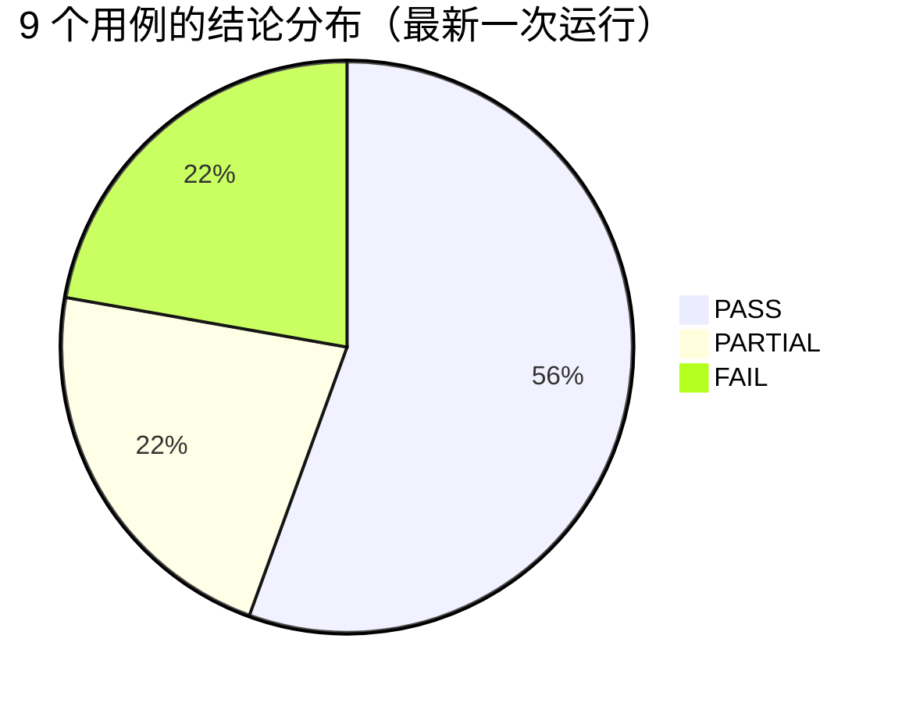
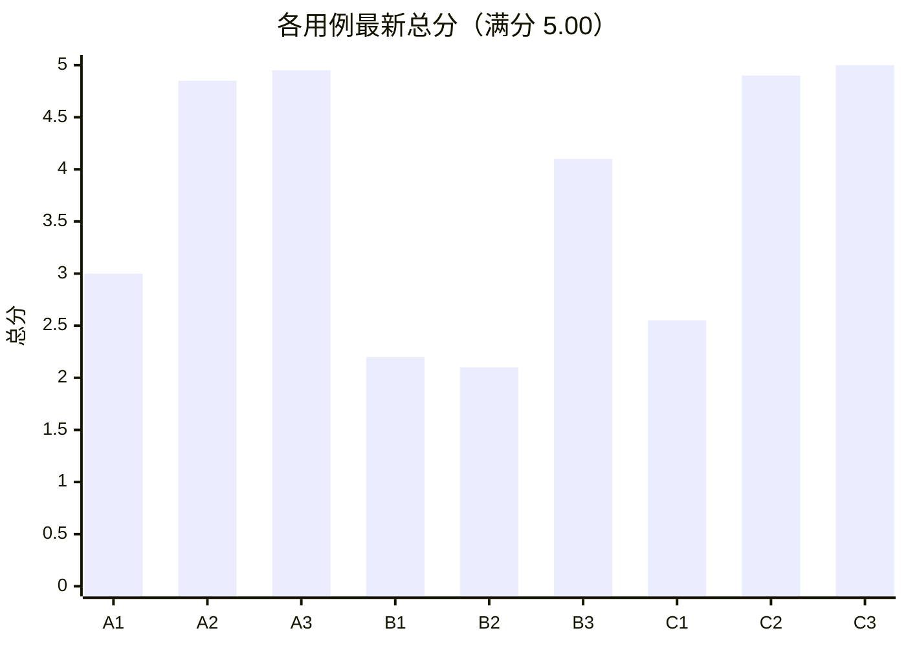
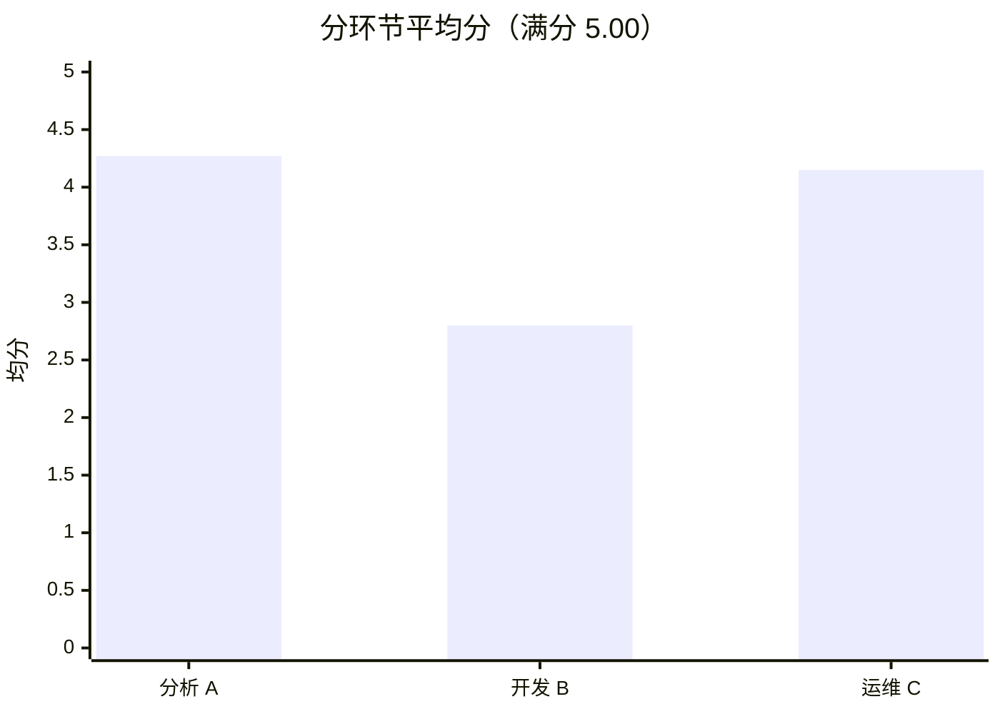
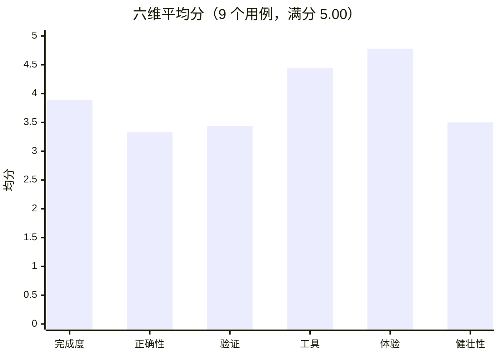

# Multi-Agent BigData Platform 系统化评测报告

> **最终描述（先读）**
>
> 本轮覆盖 **9 个用例**（分析 A1–A3、开发 B1–B3、运维 C1–C3）。按“每个用例最近一次运行”汇总：
> **5 PASS / 2 PARTIAL / 2 FAIL，展示用均分 3.74 / 5.00**。
>
> 其中 **C3 5.00、B3 4.10、B2 2.10** 是本轮新跑；**A1/A2/A3/B1/C1/C2** 是历史运行结果，
> 没有在当前代码和当前评测尺子下重测。A/C 的历史分在**各自版本**下有效，但不能直接和本轮新跑结果
> 做前后对比；本报告的 3.74 是“各用例最近一次运行”的展示用汇总，不是严格同版本回归分。
>
> B2 的 2.10 是 **data_develop 工具调用历史 400** 导致未进入验证，不是业务代码失败；
> B3 虽然 rubric 判 PASS，但 **验证完整性只有 1.5**，且存在 2 个已知业务缺陷（按你的要求留人工审核）；
> C3 是唯一完整跑通“巡检 → 转交 → 修复 → 质检 → 拒绝提交 → 租约释放”的运维链路。

---

## 1. 测试范围

| 环节 | 用例           | 目标                                                                 |
|----|--------------|--------------------------------------------------------------------|
| 分析 | A1 / A2 / A3 | Python + Spark；A1 每日行数、A2 分类型计数与 Top2、A3 去重 UV 与转化率                |
| 开发 | B1 / B2 / B3 | Java + Flink；B1 本地 WordCount、B2 Kafka PV/UV、B3 Kafka 1 分钟 Top3 销售额 |
| 运维 | C1 / C2 / C3 | 真实巡检、故障取证、转交开发、CVA 验证、提交确认、租约释放                                    |

- 驱动方式：真实 HTTP 入口（登录、`/ai/chat/stream`、`/ai/resume`、history、tool-traces、运维看板接口），不是进程内直调图。
- 集群：VM 上的 YARN / HDFS / Hive / Kafka / ZooKeeper；提交的测试应用在验证后清理。
- 数据：每个用例的 prompt、SSE 事件、工具轨迹、验证报告、集群日志和 rubric
  都在 `tests/system_eval_data/<run_id>/cases/<case_id>/`。
- 本轮新跑数据：`eval_final_B2B3/`（B2、B3）、`eval_c3_full/`（C3）；历史数据路径见第 6 节。

---

## 2. 评分口径

每个维度 **0–5 分**（满分 5.00/维）；总分是六维加权和，**总分满分 5.00**（不是 100 分制）：

```text
总分 = 0.20×完成度 + 0.30×正确性 + 0.20×验证完整性
     + 0.10×工具效率 + 0.10×体验 + 0.10×健壮性
```

| 维度                   |  权重 | 含义                                         | 主要证据                       |
|----------------------|----:|--------------------------------------------|----------------------------|
| 完成度 completion       | 20% | 流程是否走完：无 `error`、有 `done`/终态、最终答案非空、项目文件存在 | SSE、result.json、项目目录       |
| 正确性 correctness      | 30% | 结果是否正确：YARN 日志/输出 vs 期望；不提交的用例看代码与验证结果     | cluster.json、surefire、代码   |
| 验证完整性 verification   | 20% | CVA 浅层/深层是否真实执行、人工确认与提交确认是否完整、是否虚报通过       | verification.jsonl、CVA 证据  |
| 工具效率 tool_efficiency | 10% | 工具调用数、失败数、重复调用、最慢工具                        | tool_traces.json           |
| 体验/延迟 ux             | 10% | TTFB、总耗时、`status` 进度、答案结构                  | timeline.json、events.jsonl |
| 健壮性 robustness       | 10% | 编译/测试失败后的修复、深层转后台、运维 HITL 恢复               | 重试记录、后台事件、ops.json         |

**结论阈值**（`tests/system_eval/rubric.py`）：

- **PASS**：总分 ≥ 3.5 且 correctness ≥ 3；
- **PARTIAL**：总分 ≥ 2.5；
- **FAIL**：总分 < 2.5。

> 注意：验证完整性低不会单独一票否决，所以会出现“PASS，但验证完整性 1.5”的情况（B3）。

---

## 3. 总览

### 3.1 结论分布



### 3.2 各用例总分（满分 5.00）



| 用例 |   总分 | 结论      | 来源                    |
|----|-----:|---------|-----------------------|
| A1 | 3.00 | PARTIAL | `eval_main`（历史基线）     |
| A2 | 4.85 | PASS    | `eval_v3_A2d`（历史）     |
| A3 | 4.95 | PASS    | `eval_fix_A3B3`（历史）   |
| B1 | 2.20 | FAIL    | `eval_main`（历史基线）     |
| B2 | 2.10 | FAIL    | `eval_final_B2B3`（本轮） |
| B3 | 4.10 | PASS    | `eval_final_B2B3`（本轮） |
| C1 | 2.55 | PARTIAL | `eval_fixes_C1b`（历史）  |
| C2 | 4.90 | PASS    | `eval_fixes_C2`（历史）   |
| C3 | 5.00 | PASS    | `eval_c3_full`（本轮）    |

### 3.3 分环节平均分



| 环节   |      平均分 | PASS | PARTIAL | FAIL |
|------|---------:|-----:|--------:|-----:|
| 分析 A | **4.27** |    2 |       1 |    0 |
| 开发 B | **2.80** |    1 |       0 |    2 |
| 运维 C | **4.15** |    2 |       1 |    0 |

### 3.4 六维平均分



| 维度    |  平均分 | 说明                                      |
|-------|-----:|-----------------------------------------|
| 完成度   | 3.89 | 大部分流程能走完；B2 在 data_develop 阶段被框架 400 打断 |
| 正确性   | 3.33 | A2/A3/B3/C2/C3 有真实结果；B1/B2/A1 偏低        |
| 验证完整性 | 3.44 | B3 只有 1.5，B2 未进入验证；A2/A3/C2/C3 为 5      |
| 工具效率  | 4.44 | 工具调用次数可接受；B1 旧基线调用 75 次偏高               |
| 体验/延迟 | 4.78 | SSE、进度、最终答案结构基本稳定                       |
| 健壮性   | 3.50 | B2 框架 400、C1 无源码转交、A1 旧基线拖累             |

---

## 4. 各用例评分明细

| 用例 | 完成度 | 正确性 | 验证完整性 | 工具效率 |  体验 | 健壮性 |   总分 | 结论      |
|----|----:|----:|------:|-----:|----:|----:|-----:|---------|
| A1 | 5.0 | 1.0 |   1.5 |  5.0 | 5.0 | 4.0 | 3.00 | PARTIAL |
| A2 | 5.0 | 5.0 |   5.0 |  4.0 | 5.0 | 4.5 | 4.85 | PASS    |
| A3 | 5.0 | 5.0 |   5.0 |  5.0 | 5.0 | 4.5 | 4.95 | PASS    |
| B1 | 2.0 | 1.5 |   2.0 |  3.0 | 5.0 | 1.5 | 2.20 | FAIL    |
| B2 | 1.0 | 1.0 |   3.0 |  5.0 | 4.0 | 1.0 | 2.10 | FAIL    |
| B3 | 5.0 | 5.0 |   1.5 |  4.0 | 5.0 | 4.0 | 4.10 | PASS    |
| C1 | 2.0 | 1.5 |   3.0 |  5.0 | 4.0 | 2.0 | 2.55 | PARTIAL |
| C2 | 5.0 | 5.0 |   5.0 |  4.0 | 5.0 | 5.0 | 4.90 | PASS    |
| C3 | 5.0 | 5.0 |   5.0 |  5.0 | 5.0 | 5.0 | 5.00 | PASS    |

### 4.1 运行耗时与工具量（有记录时）

| 用例 |     耗时 | 工具调用数 | 备注                                |
|----|-------:|------:|-----------------------------------|
| A1 | 361.8s |    52 | 历史基线                              |
| A2 | 424.9s |    49 | 不提交，诚实地说明                         |
| A3 | 290.7s |    30 | 真实提交 app 0028 SUCCEEDED           |
| B1 | 283.9s |    75 | 历史基线；工具调用偏多                       |
| B2 | 172.5s |     8 | 本轮；data_develop 400，未进入验证         |
| B3 | 618.3s |    74 | 本轮；集群 TopN 6 项校验全过                |
| C1 | 157.2s |     — | 运维单 run，已收口                       |
| C2 | 411.1s |     — | handover → 修复 → 提交 0027 SUCCEEDED |
| C3 | 235.5s |     — | 本轮全链路 5.0                         |

---

## 5. 逐例说明

### A1：Spark 每日行数（历史基线，3.00 PARTIAL）

- 任务：统计 `fireflymall.userbehaviordata` 在 2026-03-24..03-28 每天的行数。
- 结果：流程完成，但 correctness 仅 1.0、verification 1.5，集群结果没有达到期望；属于早期基线数据。
- 说明：这条分数是旧代码/旧评测尺子下的历史结果，不代表当前版本的最终能力。

### A2：Spark 分类型计数与 Top2（4.85 PASS）

- 任务：5 天内每个 `dt` 各 `type` 计数，并给出每天 Top2 行为。
- 亮点：**不提交**，最终答案明确说明“未提交”；CVA 浅层/深层 19/19 通过。
- 证据：`eval_v3_A2d/cases/A2/`；工具调用 49 次；总耗时 424.9s。

### A3：Spark 去重 UV 与转化率（4.95 PASS）

- 任务：每天 search→cart→order→payStatus 的去重 UV 与三级转化率，先不 collect。
- 结果：真实提交 `application_1794102185683_0028` **SUCCEEDED**；CVA 浅层/深层通过；最终答案提交状态正确。
- 证据：`eval_fix_A3B3/cases/A3/`；工具 30 次；290.7s。
- 这是“分析 Agent 真实提交 + 结果正确”最完整的一条。

### B1：Flink WordCount（历史基线，2.20 FAIL）

- 任务：Kafka 5s 滚动窗口 WordCount，不提交。
- 结果：完成度 2.0、正确性 1.5、健壮性 1.5；旧基线的测试与提交链路不完整。
- 说明：历史数据，未在当前版本重跑。

### B2：Flink Kafka PV/UV（本轮，2.10 FAIL）

- 任务：Kafka JSON → 事件时间 5s watermark → 10s 滚动窗口 → 按 event 统计 PV/UV → 提交。
- 结果：data_develop 调用 8 个工具后，模型 API 返回 400：
  `assistant message with 'tool_calls' must be followed by tool messages ...`
  未进入 CVA，未提交；completion 1.0、correctness 1.0、robustness 1.0。
- 原因：`create_agent` 把并行 tool_calls 拆成多个 `Send("tools", [call])`；其中一个任务没有写出 ToolMessage，留下“半批历史”。已加：
    - `ToolCallHistoryGuard`：模型调用前补齐缺失 ToolMessage，并记录 `tool_call_id/tool_name`；
    - `max_concurrency=1`：data_develop/data_analysis 的 `ainvoke` 串行执行 Send 任务，避免半批并发写。
- 状态：这两个修复只做了离线编译/单测，没有再用真实 B2 验证。

### B3：Flink Kafka Top3 销售额（本轮，4.10 PASS，但有保留）

- 任务：1 分钟窗口按 category 统计 `price*quantity`，Top3，开 checkpoint。
- 结果：集群 6 项 TopN 校验全部通过；producer replay 10 条；应用 `application_1794102185683_0034` 被评测器在取数后 kill。
- 保留点：verification 仅 1.5；CVA 浅层 6 个中只有 2 个通过，最终仍有 2 个已知业务缺陷：
    1. `user_id` 被 Jackson 默认命名丢掉；
    2. 窗口边界整体偏移 20 秒。
       这两点按你的要求留人工审核，因此“PASS”只代表集群 TopN 输出匹配，不代表代码无缺陷。

### C1：Spark OOM 巡检（2.55 PARTIAL）

- 任务：Spark `oom_limit` 故障，巡检、取证、给出资源/提交参数建议。
- 结果：单次 run ERROR / ESCALATED；没有再次出现 8 次 lease 循环；但 completion/correctness 仍低。
- 说明：历史修复后数据，非本轮新跑。

### C2：Spark 脏数据 ETL 转交（4.90 PASS）

- 任务：数字转换 UDF 遇到脏数据，checker 检出 → 运维 handover → 分析 Agent 修复 → CVA → 提交确认 yes。
- 结果：`application_1794102185683_0027` SUCCEEDED，日志 `TOTAL_AMOUNT=60`；单 run DONE、lease 释放。
- 证据：`eval_fixes_C2/cases/C2/`。

### C3：Flink 脏数据运维全链路（本轮，5.00 PASS）

- 任务：Flink Kafka `amount="N/A"` 触发 `NumberFormatException`，fixed-delay 保持 RUNNING。
- 结果：checker 检出 → 运维 Agent 取证 → handover → Flink 开发修复 → CVA 浅层 3/3、深层 5/5 → 提交确认 **no
  ** → `agent_runs` DONE、lease 释放；单 run，无空 `out_msg`。
- 证据：`eval_c3_full/cases/C3/`；235.5s。
- 这是本轮最重要的验证：**运维转交开发的完整闭环成立**。

---

## 6. 结果有效性说明

| 用例 | 数据来源              | 有效性                          |
|----|-------------------|------------------------------|
| A1 | `eval_main`       | 历史基线；旧代码/旧尺子，仍有效但不可与当前版本直接比较 |
| A2 | `eval_v3_A2d`     | 历史修复后结果；有效                   |
| A3 | `eval_fix_A3B3`   | 历史修复后结果；真实提交成功，有效            |
| B1 | `eval_main`       | 历史基线；有效但版本较旧                 |
| B2 | `eval_final_B2B3` | 本轮；框架 400，**未验证业务**          |
| B3 | `eval_final_B2B3` | 本轮；集群输出通过，但验证完整性低、有已知业务缺陷    |
| C1 | `eval_fixes_C1b`  | 历史修复后结果；有效                   |
| C2 | `eval_fixes_C2`   | 历史修复后结果；真实提交成功，有效            |
| C3 | `eval_c3_full`    | 本轮；完整运维链路，有效                 |

**关于旧基线**：`eval_main` 的 9 例结果是 **2 PASS / 2 PARTIAL / 5 FAIL，均分 2.66**。它和本报告的 3.74
不是同一批代码、同一把尺子，不能直接宣称“提升了 1.08 分”。本报告只把它作为起点记录。

---

## 7. 本轮修复与评测工具变化

| 类别        | 变化                                                                                       |
|-----------|------------------------------------------------------------------------------------------|
| CVA 结果可见性 | 解析 `target/surefire-reports/TEST-*.xml`，把 `class#method + message` 交给 CVA，不再只看到 Maven 尾部 |
| CVA 测试闸门  | Flink `mvn test-compile`；Spark 语法 + `pytest --collect-only`；编译/收集失败不进入测试                 |
| CVA 测试管理  | `verify_test_code`、`list_test_files`、`delete_test_code`；不再每次写测试都自动编译                     |
| 应用名校验     | 注册工具校验 `/ \ : * ? " < >                                                                  |` 等路径/文件名字符；data_develop/data_analysis 的下一跳再次校验；提交节点保留最后防线 |
| 深层失败重试    | 深层失败且测试文件确实改过时，允许最多 1 次重试；重试直接进 `ver_deep_exec`，不再走人工确认                                  |
| 工具调用历史    | `ToolCallHistoryGuard` 补齐缺失 ToolMessage；`max_concurrency=1` 串行 Send 工具任务                 |
| 评测工具      | Kafka connector 精确检测并复制 kafka-clients 3.4.0；producer 在应用 RUNNING 后再发数据                   |
| 诊断锚点      | eval server 下可写 `anchors/`（Maven 原文、surefire 原文、CVA 输入/模型输出、dispatch）；正常 `run.py` 不启用    |

---

## 8. 结论与后续建议

### 结论

1. **分析链路强**：A2/A3 分别 4.85/4.95，真实提交 A3 成功；A1 是早期基线，仍需重测才能代表当前版本。
2. **运维链路强**：C3 5.0 完整闭环，C2 4.9 真实转交并提交成功；C1 仍偏低，但 lease 循环已收口。
3. **开发链路是短板**：B1 历史基线 2.2；B2 本轮 2.1 是框架 400，未验证业务；B3 4.1 但验证完整性 1.5、有 2 个已知业务缺陷。
4. **当前没有一次同版本、同尺子的全量 9 例回归**；3.74 是展示用汇总，不是严格回归分。
5. **B2 的工具调用历史问题**已加守卫和串行化，但还未在真实 B2 上复测；B3 的缺陷按你的要求留人工审核。

### 建议

- 若只做一件事：**在修复后的代码上单跑一次 B2**，确认 `max_concurrency=1 + ToolCallHistoryGuard` 是否消除 400；
- 若还愿意继续：让 B3 的 2 个业务缺陷单独修复并复测（user_id 映射、窗口偏移 20s）；
- A1/B1/C1 的低分是历史数据，是否重测取决于你是否需要“当前版本全量分”；
- C3 已通过，不需要再动。

---

## 9. 数据与复现

- 评测代码：`tests/system_eval/`
- 原始数据：`tests/system_eval_data/`
- 本轮关键目录：
    - `eval_final_B2B3/cases/B2/`、`eval_final_B2B3/cases/B3/`
    - `eval_c3_full/cases/C3/`
    - `eval_anchor_B2/anchors/`（工具调用与 surefire 原始锚点）
- 报告生成时间：2026-11-08
- 说明：本报告不修改任何测试数据；所有分数来自对应 run 的 `rubric.json`。
